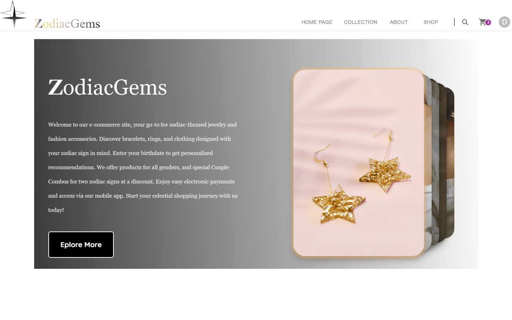
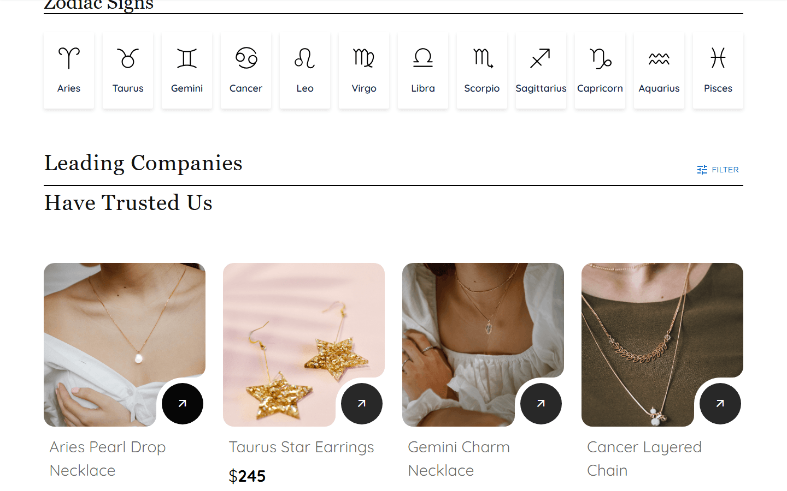
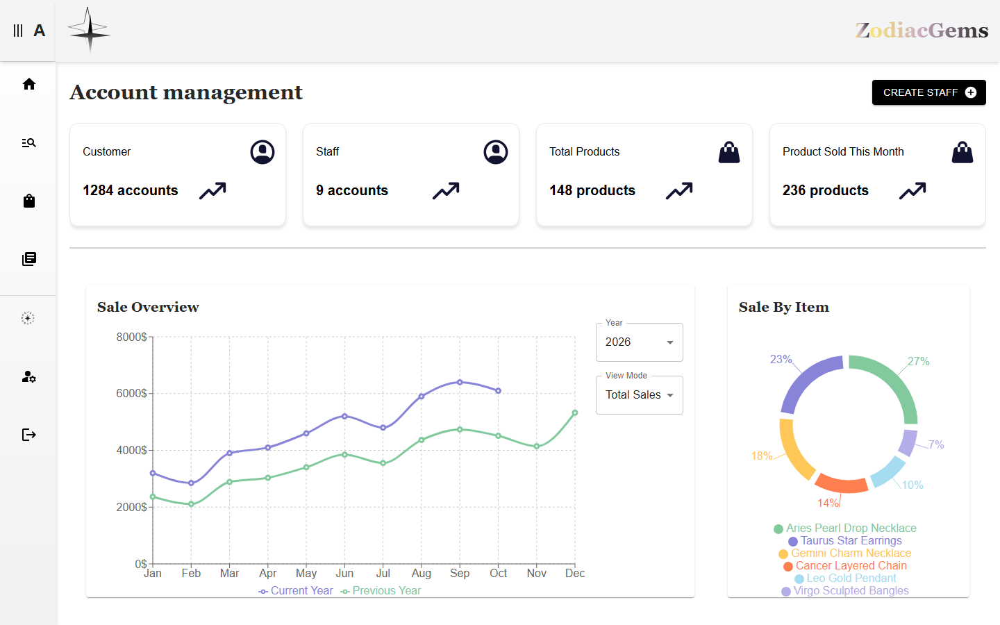

# ZodiacGems — web app

Jewelry store where customers browse pieces by zodiac sign, plus admin and staff consoles to run the catalog and orders.

**Status:** Course project (SWD392), FPT University, 2024 — archived. The backend is offline, so the live demo loads but cannot sign in or load products.

Related: [ZodiacGems-MobileApp](https://github.com/Let-cal/ZodiacGems-MobileApp) (Flutter customer app for the same backend).

## Screenshots

Captured from a local build with mocked API responses (the backend is offline). Products, prices and orders in the images are sample data.

| | |
| --- | --- |
|  |  |
|  | |

## My role

Team Lead and front-end developer. In this repository I built:

- **Admin console:** dashboard with charts, product management (create, update, delete, images), collection management, zodiac data, order management, staff accounts.
- **Staff console:** product, collection, zodiac and order management.
- **Accounts:** login, registration, password reset with an email OTP, change password.
- **Customer pages:** header, zodiac filter on the home page, collection cards, profile and order history.
- **Deployment:** Vercel configuration for client-side routing.

Product detail, cart and checkout were mainly built by [@giabao25](https://github.com/giabao25).

## Team

Commits in this repository: [@Let-cal](https://github.com/Let-cal) and [@giabao25](https://github.com/giabao25).

## Stack

React 18, Vite, JavaScript, MUI, Tailwind CSS, styled-components, React Router, Axios, Recharts, notistack, SweetAlert.

## Features

- Three roles: customer, staff, admin.
- Customers browse products and collections, filter by zodiac sign, add to cart, check out and see their orders.
- Checkout marks the order as paid through the backend API. No payment provider is called from this front end (the `payos-checkout` package is installed but not used).
- Staff and admins manage products, collections, zodiac data and orders, with statistics charts; admins also manage staff accounts.

## How to run

```sh
npm ci
npm run dev        # development server
npm run build      # production build
npm run preview    # serve the production build
```

API URLs are hard-coded in the components. They point to the old Azure backend, which no longer exists.

## Known limitations

- The backend is offline, so sign-in and all data screens fail outside a mocked setup.
- No automated tests.
